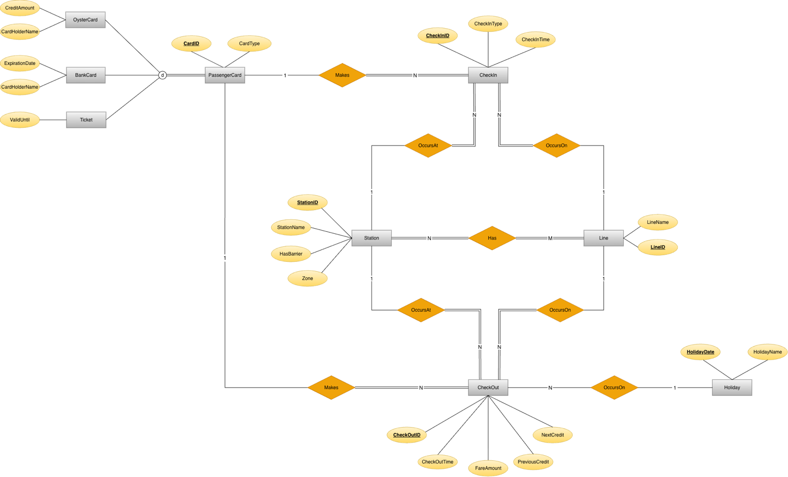
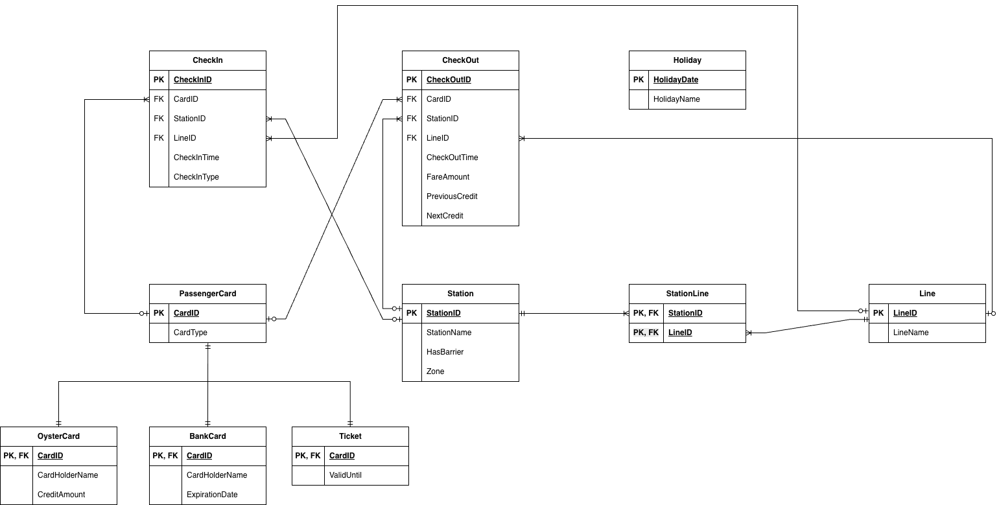

# London Underground Transportation Database

**Oracle SQL and PL/SQL | ER modelling to BCNF | 10 tables, 3 triggers, 4 views, 12 queries**

I built this database to record and analyse how passengers travel on the London Underground: which card they use, where and when they tap in and out, which line they travel on and how much they pay. The project takes the design from a conceptual ER model, through normalisation to BCNF, to a working Oracle implementation with triggers, views and analytical queries.

**[Read the full project report (PDF)](report/London_Underground_Database_Report.pdf)**

The project was completed during my MSc Computer Science at Queen Mary University of London. It runs on a small, purpose-built sample dataset, not on real Transport for London (TfL) records.

## What the queries show

These results come from the sample data in the script. They show what the views and queries can answer, not real TfL figures.

- **The District line collected the highest fares.** It recorded **12** journeys and **£46.00** in fares, about twice the next line, Jubilee (**£23.30**).
- **Zone 1 generated the most revenue.** It had **19** check-outs and **£86.30** in fares, with an average fare of **£4.54**.
- **King's Cross St Pancras was the busiest station.** It had **7** check-ins and **5** check-outs, **12** taps in total.
- **The morning peak is clear.** **08:00–08:59** had **11** check-ins, the most of any hour, followed by **09:00–09:59** with **8**.
- **Average fares differ by card type.** Oyster journeys averaged **£4.09**, bank card journeys **£3.85** and ticket journeys **£3.23**.
- **Incomplete journeys can be traced back to the card.** The `IncompleteJourneys` view lists **4** check-ins with no matching check-out, from **2** Oyster cards, **1** bank card and **1** ticket.

## Database design

**Conceptual schema (ER model)**

[](images/conceptual-schema.png)

**Relational schema**

[](images/relational-schema.png)

The main design decisions were:

- **One parent table for all card types.** `PassengerCard` holds what every card shares. `OysterCard`, `BankCard` and `Ticket` hold only their own details and use `CardID` as both primary key and foreign key. The design treats this as a disjoint and total specialisation: each card belongs to exactly one subtype, and each subtype table holds only the columns that apply to it.
- **Check-ins and check-outs in separate tables.** A passenger can tap in without tapping out, or the other way round. Keeping the two events apart means incomplete journeys are recorded rather than lost. Check-ins and check-outs are matched at query time by card and time.
- **A link table for stations and lines.** One station can be served by several lines, and one line has many stations. `StationLine` resolves this many-to-many relationship with a composite primary key.
- **No foreign key to `Holiday`.** Storing the holiday date in `CheckOut` would repeat the date already held in `CheckOutTime`. Queries match the date part of `CheckOutTime` to `HolidayDate` instead.
- **Balance history kept with each journey.** `CheckOut` stores the Oyster balance before and after each journey (`PreviousCredit` and `NextCredit`), while `OysterCard` keeps the current balance.

## Tables

| Table | Content |
| --- | --- |
| `PassengerCard` | Every card and its type: Oyster, bank card or ticket |
| `OysterCard` | Card holder name (optional for anonymous cards) and current balance |
| `BankCard` | Card holder name and expiry date |
| `Ticket` | The date the ticket is valid until |
| `Station` | Station name, zone (1–6) and whether the station has barriers |
| `Line` | Line name |
| `StationLine` | Which lines stop at which stations |
| `CheckIn` | Each tap-in: card, station, line, time and reader type (standard or pink) |
| `CheckOut` | Each tap-out: card, station, line, time, fare and Oyster balance before and after |
| `Holiday` | UK public holiday dates and names |

## Business rules (triggers)

Declarative constraints by their nature cannot enforce certain business rules. For instance, checking the expiry date of the cards involves comparisons of dates in different tables. Also, the process of updating the Oyster Card's balance after checkout operations involves coordinated updates from the CheckOut table and the OysterCard table. To handle these scenarios, triggers have been used:

| Trigger | Runs | What it does |
| --- | --- | --- |
| `validate_travel_expiry` | Prior to the insertion of the CheckIn record | Prevents the entry of passengers if their BankCard or Ticket is expired |
| `prevent_negative_entry` | Prior to the insertion of the CheckIn record | Prevents Oyster cards from entering the system if their credit amount is £0 or below |
| `update_card_balance` | Immediately after the insertion of the CheckOut record | Automatically updates the Oyster card balance based on the successful completion of the journey |

## Views and queries

| View | What to look for |
| --- | --- |
| `LineFaresSummary` | Total fares collected for each line |
| `ZoneRevenueSummary` | Zone-based revenue summary with total check-out |
| `IncompleteJourneys` | Incomplete journeys where passengers checked in but never checked out |
| `StationActivity` | Station activity with total check-in and check-out counts |

| Query | Question it answers |
| --- | --- |
| 1 | Which stations are on the Northern line? |
| 2 | Which bank cards and tickets have expired? |
| 3 | How much fare was collected on each line? |
| 4 | What is the average fare for each card type? |
| 5 | How many journeys were made on each public holiday? |
| 6 | How many check-ins happen in each hour of the day? |
| 7 | Which passengers made more than three completed journeys? |
| 8 | Which transit stations and line changes are most popular, based on pink reader use? |
| 9 | What was the most expensive journey? |
| 10 | Which station has the most check-ins and check-outs? |
| 11 | Which passengers have at least one incomplete journey? |
| 12 | Which routes between stations are travelled most often? |

The report shows the output of every view and query.

## Sample data

The test data was written to cover normal journeys and the unusual cases the queries need to catch:

- **14 stations** across all six zones and **8 lines**: District, Jubilee, Northern, DLR, Elizabeth, Piccadilly, Central and Victoria
- **15 cards:** 6 Oyster cards, 5 bank cards and 4 tickets
- **45 check-ins** and **40 check-outs**, including journeys on **4** UK public holidays
- **Incomplete journeys** in both directions: check-ins without a check-out and check-outs without a check-in

All card holder names and card numbers are made up.

## A short glossary

| Term | Meaning here |
| --- | --- |
| **Oyster card** | A prepaid travel card. The fare is taken from the card balance. |
| **Bank card** | A contactless debit or credit card used to pay for travel. The card is checked for expiry; payment is handled outside the database. |
| **Pink card reader** | An optional reader at some interchange stations, used so the fare can be calculated more accurately. Here it is stored as a `PinkReader` check-in. |
| **Zone** | London's fare zones. This project uses zones **1** (central) to **6** (outer). |
| **Incomplete journey** | A check-in with no matching check-out, or a check-out with no matching check-in. |
| **BCNF** | Boyce–Codd Normal Form: every determinant in a table is a candidate key. |

## Repository structure

```text
london-underground-database/
├── images/
│   ├── conceptual-schema.png
│   └── relational-schema.png
├── report/
│   └── London_Underground_Database_Report.pdf
├── README.md
└── london_underground.sql
```

`london_underground.sql` contains everything in run order: table definitions, triggers, sample data, views and queries.

## How to run the script

The script is written for **Oracle** and was tested in **Oracle Live SQL**.

1. Open Oracle Live SQL, or any Oracle database where you can create tables.
2. Paste the full contents of [`london_underground.sql`](london_underground.sql) into a SQL worksheet.
3. Run it as a script.

The script starts with `DROP TABLE` statements so that it can be run again from a clean state. On the first run, these return "table or view does not exist" errors, which can be ignored.

## Limitations

This project is built on a small sample dataset, so the results show how the database works rather than real passenger behaviour. Fares are stored as provided; the database does not calculate them. Check-ins and check-outs are matched at query time by card and time, not by a shared journey ID. Query 2 compares expiry dates with `SYSDATE`, so its output depends on the date the script is run. The script uses Oracle-specific syntax (`VARCHAR2`, `NUMBER`, `TO_DATE`, `TRUNC`, `SYSDATE` and PL/SQL triggers) and will not run unchanged on MySQL or PostgreSQL.

This is an independent portfolio project and is not connected to, or endorsed by, Transport for London.
